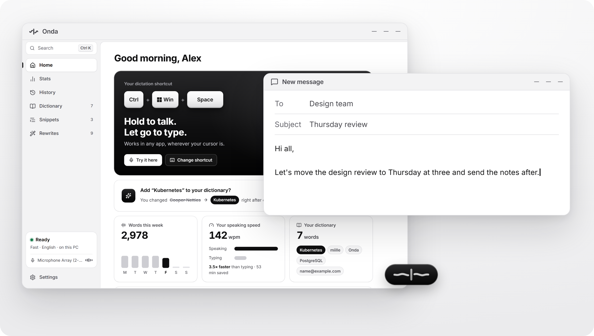
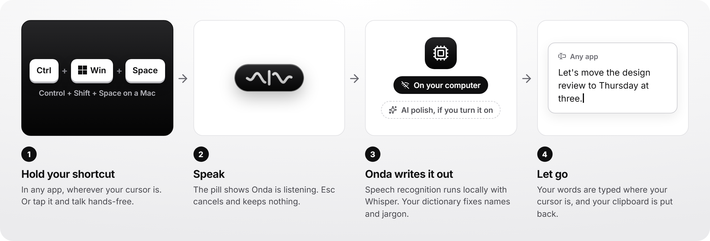
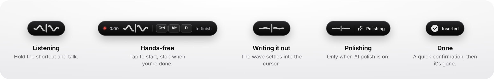
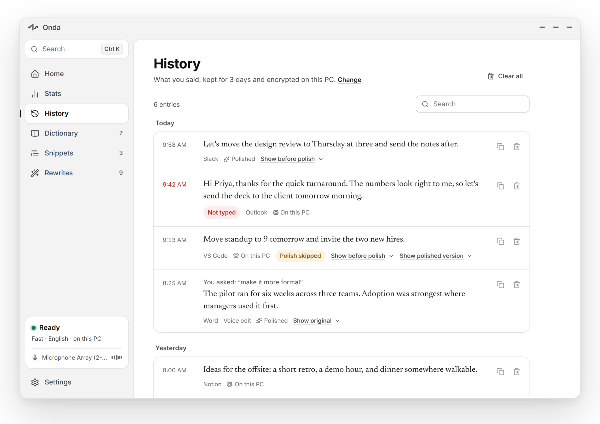
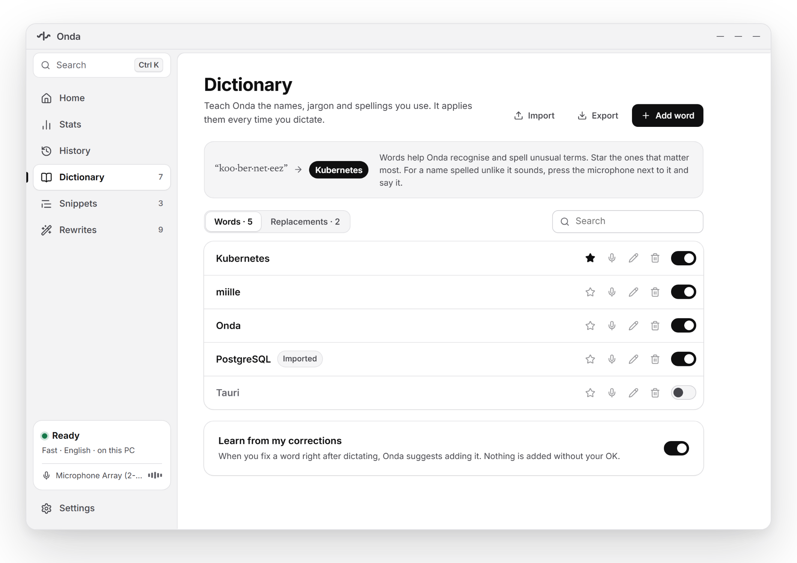
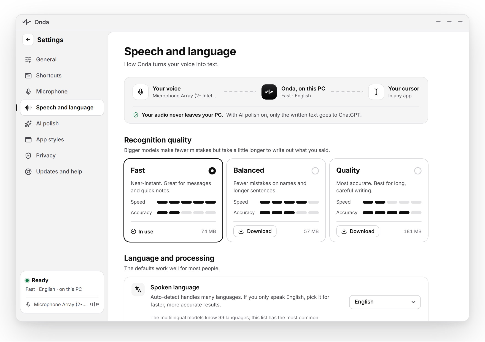
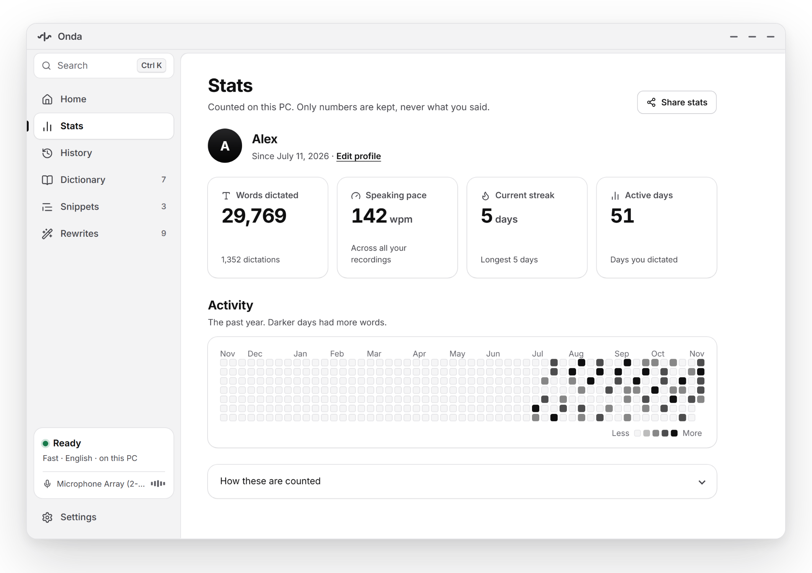
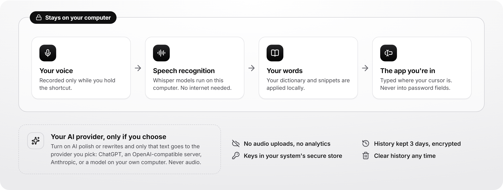

<div align="center">

<picture>
  <source media="(prefers-color-scheme: dark)" srcset="docs/images/onda-logo-dark.svg">
  
</picture>

# Onda: voice dictation that types wherever your cursor is

**Hold a key, speak, let go. Your words are typed into any app.**<br>
Private speech-to-text for Windows, macOS and Linux. Whisper runs on your own computer, so dictation works offline;<br>
AI cleanup is optional and uses the provider you choose.

[](https://github.com/miillehq/onda/releases)
[](https://github.com/miillehq/onda/actions/workflows/ci.yml)
[](https://github.com/miillehq/onda/releases)
[](LICENSE)


[**Download**](#download) · [How it works](#how-it-works) · [Features](#features) · [Privacy](#privacy) · [FAQ](#faq) · [Contributing](CONTRIBUTING.md)

<br>

<picture>
  <source media="(prefers-color-scheme: dark)" srcset="docs/images/hero-dark.png">
  
</picture>

</div>

## Download

Get the installer for your system from the [**latest release**](https://github.com/miillehq/onda/releases/latest). Onda is free and open source.

| System | Installer | Notes |
| --- | --- | --- |
| **Windows** 10 and 11 | `x64-setup.exe`, or `arm64-setup.exe` for Windows on ARM | Installs for your account; no administrator rights needed. |
| **macOS** 12 or later (experimental) | `aarch64.dmg` for Apple Silicon, `x64.dmg` for Intel Macs | Drag Onda to Applications. |
| **Linux** | `.deb` for Ubuntu and Debian, `.AppImage` for other distributions; x64 and ARM64 | Needs glibc 2.39 or newer: Ubuntu 24.04 or later, Debian 13, Fedora 42, Arch. |

> [!NOTE]
> 0.3.0 is a pre-release and its installers are not code-signed yet. On Windows, SmartScreen warns the first time: choose **More info › Run anyway**. On a Mac, open Onda once, then allow it under **System Settings › Privacy & Security › Open Anyway**. Each release lists SHA-256 checksums to check your download against.

The first time Onda starts, it checks your microphone, downloads a speech model (about 75 MB for the default) and lets you try a dictation.

## How it works

<picture>
  <source media="(prefers-color-scheme: dark)" srcset="docs/images/how-dark.png">
  
</picture>

1. **Hold your shortcut** in any app: <kbd>Ctrl</kbd> + <kbd>Win</kbd> + <kbd>Space</kbd> on Windows and Linux, <kbd>Control</kbd> + <kbd>Shift</kbd> + <kbd>Space</kbd> on a Mac. Or tap it and talk hands-free.
2. **Speak.** A small pill shows that Onda is listening. <kbd>Esc</kbd> cancels and keeps nothing.
3. **Let go.** Onda turns your speech into text on your computer, applies your dictionary and snippets, and types it where your cursor is. What you had copied is put back on the clipboard.

<picture>
  <source media="(prefers-color-scheme: dark)" srcset="docs/images/pills-dark.png">
  
</picture>

## Features

- **Types into any app.** Email, chat, documents, browsers, code editors, terminals: wherever there is a text cursor. Onda checks that the field you started in is still the one in front, and never types into password fields.
- **Offline speech recognition.** [Whisper](https://github.com/ggml-org/whisper.cpp) models run on your computer in a separate worker process. Pick Fast, Balanced or Quality; a faster build is used automatically on processors that support it.
- **39 languages, or automatic detection.** Choose English for the smaller English-only models.
- **Your words, spelled your way.** A personal dictionary for names and jargon, snippets that expand a spoken phrase into longer text, and suggestions when you correct a word right after dictating.
- **Rewrite selected text.** Select text and say what to change, or apply a saved rewrite such as "make it shorter", "fix the grammar" or "turn this into bullets". Rewrites use your AI provider.
- **Optional AI polish.** Clean up filler words and punctuation with ChatGPT (sign in with your plan), any OpenAI-compatible server, Anthropic, or a model running on your own computer. If the provider fails, you keep your original words.
- **App styles.** Onda adapts per app: a casual tone in chat, a different paste key in a terminal.
- **History and stats.** Recent dictations to copy or paste again, kept encrypted for 3 days by default. Words dictated, speaking pace and streaks, counted without storing what you said.
- **Stays out of the way.** Onda lives in the tray or menu bar; dictation, hands-free, cancel and rewrites each have their own shortcut. Light, dark and high-contrast themes follow your system.

<table>
  <tr>
    <td width="50%">
      <picture>
        <source media="(prefers-color-scheme: dark)" srcset="docs/images/screen-history-dark.png">
        
      </picture>
      <p align="center"><b>History</b>: copy or paste a recent dictation again.</p>
    </td>
    <td width="50%">
      <picture>
        <source media="(prefers-color-scheme: dark)" srcset="docs/images/screen-dictionary-dark.png">
        
      </picture>
      <p align="center"><b>Dictionary</b>: names and jargon, spelled right.</p>
    </td>
  </tr>
  <tr>
    <td width="50%">
      <picture>
        <source media="(prefers-color-scheme: dark)" srcset="docs/images/screen-speech-dark.png">
        
      </picture>
      <p align="center"><b>Speech</b>: choose speed or accuracy, and your language.</p>
    </td>
    <td width="50%">
      <picture>
        <source media="(prefers-color-scheme: dark)" srcset="docs/images/screen-stats-dark.png">
        
      </picture>
      <p align="center"><b>Stats</b>: your pace and streaks; only numbers are kept.</p>
    </td>
  </tr>
</table>

## Privacy

<picture>
  <source media="(prefers-color-scheme: dark)" srcset="docs/images/privacy-dark.png">
  
</picture>

- **Your voice never leaves your computer.** Audio is recorded only while you dictate, transcribed locally, and never written to disk.
- **AI is opt-in.** Only when you turn on AI polish or rewrites does the text (never the audio) go to the one provider you picked. Onda never falls back to another provider.
- **No analytics, no telemetry.** Logs hold timings and error codes, never your words.
- **History is encrypted on disk** with a key in your system's secure store (Windows account, macOS Keychain or the Linux keyring), kept 3 days by default, and can be cleared or turned off.

The full data-flow and threat model is in [docs/security.md](docs/security.md).

## Platform support

| | Windows | Linux | macOS |
| --- | --- | --- | --- |
| Status | Supported | Supported (X11 and Wayland) | Experimental |
| Processors | x64, ARM64 | x64, ARM64 | Apple Silicon, Intel |
| Types into apps | Yes | Yes, after the desktop allows it once | After you allow Onda under Privacy & Security › Accessibility; otherwise copied for <kbd>⌘</kbd><kbd>V</kbd> |

macOS typing into other apps is new in 0.3.0 and has not yet been tried on a real Mac; every build is tested on GitHub's Mac runners. What has been proven on which platform, and how, is recorded in [VERIFICATION.md](VERIFICATION.md).

## FAQ

<details>
<summary><b>Does Onda work offline?</b></summary>

Yes. Speech recognition runs on your computer. You need the internet only to download a speech model the first time, and for AI polish if you turn it on.
</details>

<details>
<summary><b>Is Onda free?</b></summary>

Yes, and open source under the Apache 2.0 license. AI polish uses your own account with the provider you choose, or a model running on your computer at no cost.
</details>

<details>
<summary><b>Which languages can I dictate in?</b></summary>

Settings offers 39 languages, including English, Spanish, French, German, Portuguese, Italian, Dutch, Polish, Japanese, Korean, Chinese (Mandarin), Hindi and Arabic. Automatic detection handles the rest of what Whisper's multilingual models know.
</details>

<details>
<summary><b>What computer do I need?</b></summary>

No graphics card or API key is needed. The default Fast model uses about 400 MB of memory; Quality needs about 1.2 GB and works best with 6 GB of RAM or more. Processors with AVX2 (most from 2013 on) get a faster speech engine automatically.
</details>

<details>
<summary><b>Why does Windows or macOS warn me when I install it?</b></summary>

The 0.3.0 installers are not code-signed yet, so Windows SmartScreen and macOS Gatekeeper don't recognise the publisher. Check the download against the release's SHA-256 checksums, then choose **Run anyway** on Windows or **Open Anyway** in macOS's Privacy & Security settings.
</details>

<details>
<summary><b>On a Mac, why does my dictation land on the clipboard?</b></summary>

macOS lets an app type into other apps only after you turn it on under **System Settings › Privacy & Security › Accessibility**. Onda's **Settings › Shortcuts › Typing into apps** has an Allow button that takes you there. Because the app is unsigned, macOS may ask again after an update: switch Onda off and on in that list.
</details>

## Build from source

You need Rust 1.95, Node 24, CMake and LLVM (for whisper.cpp), and on Windows the Visual Studio 2022 C++ build tools.

```bash
npm ci
./scripts/prepare.ps1      # Windows; scripts/prepare.sh on Linux and macOS
npm run desktop            # Windows; npm run tauri dev on Linux and macOS
```

To work on the interface alone, `npm ci && npm run dev` serves it at http://127.0.0.1:1420 against a labelled development mock, with no Rust or speech toolchain. [CONTRIBUTING.md](CONTRIBUTING.md) has the full setup per platform, the test commands and how changes are reviewed.

## Contributing

Bug reports, ideas and pull requests are welcome. Start with [CONTRIBUTING.md](CONTRIBUTING.md); [ARCHITECTURE.md](ARCHITECTURE.md) explains how the pieces fit, and [docs/README.md](docs/README.md) lists the rest of the documentation. Please report security issues privately, as [SECURITY.md](SECURITY.md) describes, not in public issues.

## License

Onda is licensed under the [Apache License 2.0](LICENSE). Bundled components keep their own licenses: see [THIRD_PARTY_NOTICES.txt](THIRD_PARTY_NOTICES.txt) and [docs/third-party-licenses.md](docs/third-party-licenses.md).

<div align="center"><sub>Onda by miille</sub></div>
